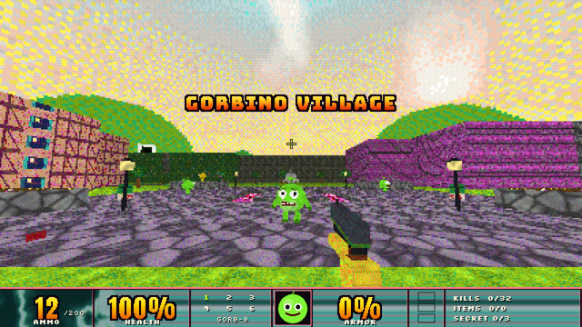
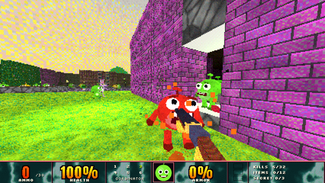
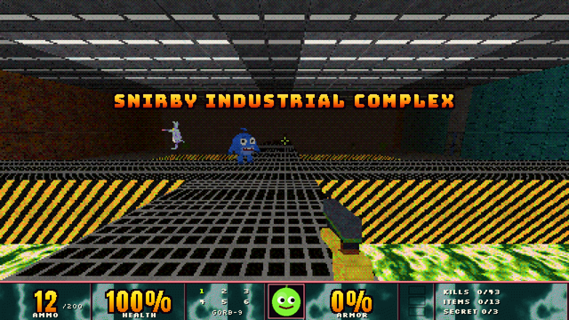
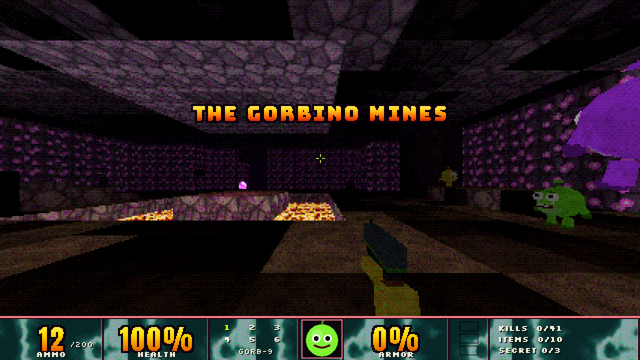
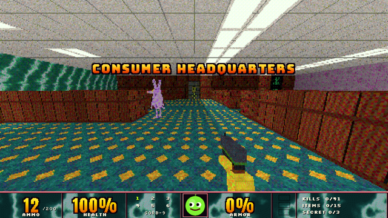
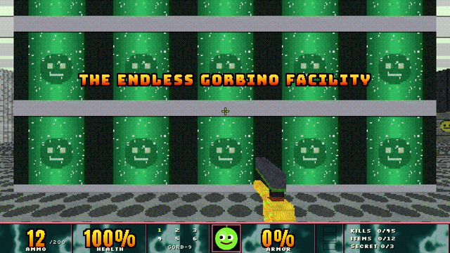
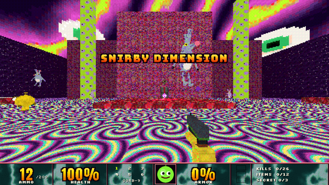
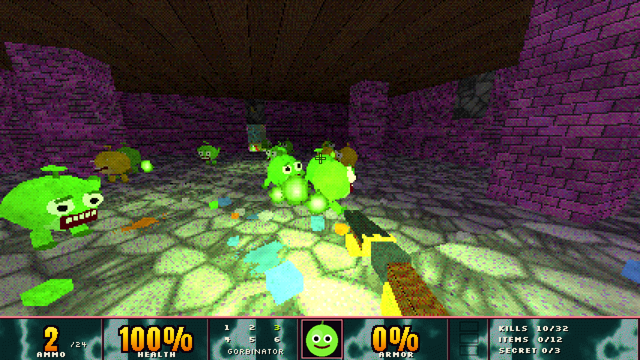

# GORBINO'S QUEST

*The first-person Gorb experience.* (C) 1996 Glandcore Software (alternate history), built in 2026 with Godot 4.5.


Gorbino's Quest is a standalone, fast first-person shooter in the spirit of DOOM, Quake and DUSK, imagined as the game the people of the Cruelty Squad universe have been playing for years. It is an unofficial fan interpretation. It contains no assets from Cruelty Squad: every texture, model, sound and music track is original and generated by the scripts in `tools/`.

There are only two kinds of creature in the game, the **Gorbino** and the **Snirby**. You shoot both.

| | |
|---|---|
|  |  |
|  |  |
|  |  |
|  |  |

## Playing it

**Windows:** unzip `build/GorbinosQuest-Windows.zip` and run `GorbinosQuest.exe`. It's a single self-contained executable with no installer. It runs on the OpenGL 3.3 "Compatibility" renderer, so almost any GPU from the last 15 years works.

**From source:** install [Godot 4.5.1](https://godotengine.org/download), open `project.godot` and press F5. Or run `godot --path .`.

### Controls (all rebindable in OPTIONS > CONTROLS > KEY BINDINGS)

| Action | Default |
|---|---|
| Move | W A S D / arrow keys |
| Look | Mouse |
| Fire | Left mouse / Ctrl |
| Use / open doors / switches | E / Right mouse |
| Jump | Space |
| Sprint | Shift |
| Reload | R |
| Weapons | 1-6, mouse wheel, Q = last weapon |
| Automap | Tab |
| Quick save / quick load | F5 / F9 |
| Pause menu | Esc |

Doors also open when you walk into them, except locked doors (find the keycard) and secret walls (look for odd textures and press USE).

## The game

### Episode: six levels, one campaign

1. **Gorbino Village**: an open village under a sickly sky, with a plaza, temple, barn, pond and a red-locked town gate.
2. **Snirby Industrial Complex**: loading yards, a sludge-pit processing hall with catwalks, vats, a packaging line and a switch-operated armory.
3. **The Gorbino Mines**: dark caves, crystal caverns, magma, rail tunnels, mine elevators and a very deep shaft.
4. **Consumer Headquarters**: a corporate tower of garish carpets and cubicles, with elevators to the boardroom and a rooftop helipad.
5. **The Endless Gorbino Facility**: cloning vats and a corridor that never ends until you find the right switch.
6. **Snirby Dimension**: flesh islands over an ooze void, and the final boss, **The Great Snirby**.

Each level has its own palette, architecture, music track and ambience, plus 3 secrets, keycards, monster-closet ambushes and checkpoints. Between levels there's a story screen and a stats tally (kills, items, secrets, time vs. par) with an S/A/B/C/D rank. Finish level 6 for the ending and credits.

### Arsenal

| Slot | Weapon | Ammo | Notes |
|---|---|---|---|
| 1 | GORB-9 Pistol | bullets | 12-round mag, accurate |
| 2 | Pumper Shotgun | shells | 6 shells, loaded one at a time (fire to interrupt), pump action |
| 3 | The Gorbinator | shells | double barrel, 20 pellets, break-action reload |
| 4 | GORB-O-MATIC | bullets | spinning-barrel machine gun, 60-round drum, spread blooms |
| 5 | GORB-POPPER | rockets | splash damage; rocket jumping works |
| 6 | SNIRB-O-TRON | cells | plasma bolts; no mag but it overheats (press R to vent) |

Recoil, muzzle flashes, dynamic muzzle lighting, ejected casings, viewmodel sway and bob, and procedural reload animations are all included.

### Bestiary

All Gorbinos share one model in different colours. All Snirbies share another.

- **Green Gorbino**: lobs green goo.
- **Yellow Gorbino**: carries a pistol and fires 3-round hitscan bursts while keeping its distance.
- **Red Gorbino**: a fast melee charger that bites.
- **Blue Gorbino**: a slow tank that fires spreads of ice orbs.
- **Purple Gorbino**: floats and fires homing orbs.
- **Black Gorbino**: a big elite with glowing eyes and a shoulder rocket launcher.
- **Snirby**: lanky, long-snouted and sniffing; it hops fast, scratches and spits.
- **Sky Snirby**: spins its ears like a propeller, flies and spits.
- **The Great Snirby**: the final boss. It cycles spit fans, summons Snirbies, fires homing barrages and rains fire.

Enemies wake on sight or when they hear gunfire through the level, path around the map with a flow field, open doors, strafe, feel pain, gib on overkill and drop ammo.

### Options

Master, music and SFX volume. Window mode, resolution, **pixel crunch** (render scale 1/1 to 1/6), **colour depth** (8-bit or 12-bit dithered, or true colour), FOV, brightness, vsync and FPS limit. Mouse speed and invert. Full key rebinding. Head bob, crosshair style, auto-reload and FPS counter. Settings are saved to `user://settings.cfg`.

### Saving

There's an autosave at the start of every level, and checkpoint totems (the spinning green heads) autosave mid-level. You can save to 3 manual slots from the pause menu, and quick save/load with F5/F9. **Continue Quest** on the title screen lists every save. Saves capture the full level state: enemies, pickups, doors, switches, secrets, keys and inventory.

## How it's built

The whole game is GDScript; scenes are built in code from data.

```
scripts/
  autoload/      settings (config + keybinds), audio (pools, music), game (flow, saves)
  level/         level.gd: grid level builder, sector lighting, doors/lifts, triggers,
                 secrets, teleporters, flow-field pathing; mover.gd; mat.gd (materials)
  player/        player.gd (movement, stairs, damage), weapons.gd (all 6 weapons)
  enemies/       enemy.gd (AI + variants), models.gd (Gorbino/Snirby/weapons/pickups),
                 projectile.gd
  fx/            explosions, blood, gibs, decals, dynamic lights, pickups, barrels, props
  ui/            HUD, menus, intermission, story, ending, splash
  levels/        level data (generated by tools/levels/*.py)
  test/          headless test runner + autopilot bot
shaders/         world (sector light + fog + dynamic lights), post (dither), sky
tools/           asset generators (textures, sprites, fonts, SFX, music) + level kit
```

**Rendering.** Levels are DOOM-style sector grids: every cell has its own floor and ceiling height, textures and light level. The 3D view renders into a low-resolution SubViewport and is upscaled with nearest filtering, then a dithered colour-depth reduction is applied. The world shader samples a per-cell light texture (with flicker, pulse and strobe sectors), applies distance diminishing and coloured fog, and adds up to 6 dynamic point lights.

**Levels** are authored in Python (`tools/levels/*.py`) with a small kit (`tools/levelkit.py`) that carves rooms by coordinates and emits GDScript data plus a top-down preview PNG (`tools/previews/`).

**Assets** are reproducible:

```
python3 tools/gen_textures.py   # 137 textures, 64x64, quantised to the 256-colour GORBPAL
python3 tools/gen_sprites.py    # explosions, flashes, projectiles, UI art, baked bitmap fonts
python3 tools/gen_audio.py      # 81 sound effects incl. formant-synthesised GORB! / SNIRB! voices
python3 tools/gen_music.py      # 10 music tracks (needs ffmpeg with libvorbis)
python3 tools/levels/level1_village.py   # ...and so on for each level
```

(The Python tools need numpy, scipy and Pillow.)

### Testing

```
tools/check_scripts.sh                                   # static check of every script
godot --headless --path . -- --test                      # build every level, prove the exit is reachable
godot --headless --path . -- --test --savetest           # save/load round trip
godot --headless --fixed-fps 120 --path . -- --autoplay  # a bot plays the whole campaign
godot --headless --fixed-fps 120 --path . -- --autoplay --single --level=3 --arsenal
```

The level validator runs a breadth-first search over each map with the player's movement rules, collecting keys and firing switches and triggers, to prove the exit can be reached. The autopilot bot then plays the levels with the real player physics: it paths to keys, switches and exits, opens doors, rides lifts, climbs stairs and fights.

### Exporting

`export_presets.cfg` contains Windows and Linux presets; install the Godot 4.5.1 export templates, then run:

```
godot --headless --path . --export-release "Windows Desktop" build/windows/GorbinosQuest.exe
```

## Credits

- Design, code, art, audio and levels: generated for this project. Fictional publisher: Glandcore Software.
- Fonts (SIL Open Font License, licences in `assets/fonts/`): Silkscreen (Jason Kottke), Bungee (David Jonathan Ross), Anton (Vernon Adams), VT323 (Peter Hull).
- Engine: [Godot Engine](https://godotengine.org) (MIT).
- This is an unofficial fan work inspired by Gorbino's Quest from the *Cruelty Squad* universe (Consumer Softproducts). It has no affiliation with them, and it contains none of their assets.
