# GORBINO'S QUEST

(C) 1996 Glandcore Software (alternate history). Built with Godot 4.5.

> **Requires Godot 4.5 or newer to open the source.** Godot 3.x cannot read the project file. To just play, use the Windows build below.

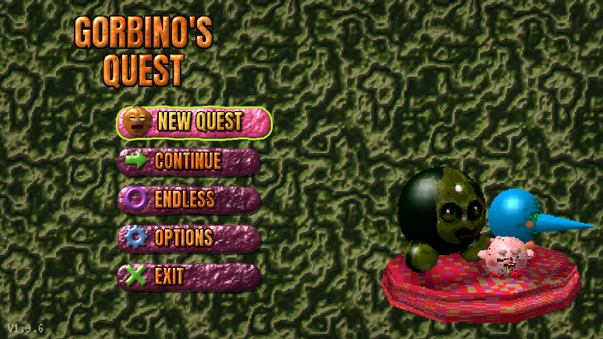

Gorbino's Quest is a standalone, fast first-person shooter in the spirit of DOOM, Quake and DUSK, imagined as the game the people of the Cruelty Squad universe have been playing for years. It is an unofficial fan interpretation. The Gorbino model and texture and the Snirby face texture were supplied by the project owner (see `tools/user_models/`), as were the gun sounds and voice lines. Every other texture, model, sound and music track is generated by the scripts in `tools/`.

There are three kinds of creature in the game. The **Gorbino** is a glossy round blob with big glassy eyes, standing on two round feet. The **Snirby** is a blue ball with green eyes, red cheeks, a green-toothed grin, orange shoes and a long beak in the same blue skin. The **Snotling** is a little pink, lumpy, snot-nosed blob. You shoot all of them.

| | |
|---|---|
| 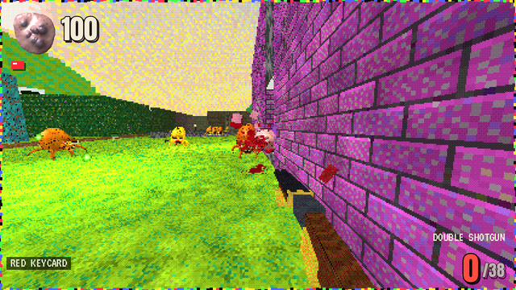 | 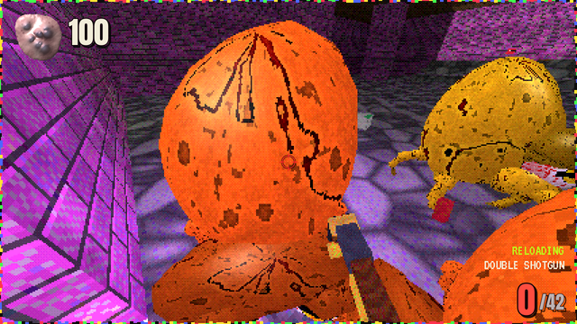 |
| 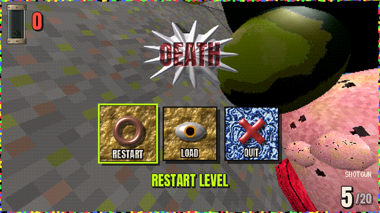 | 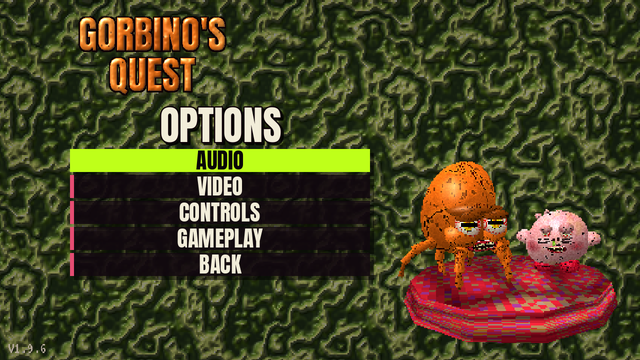 |
| 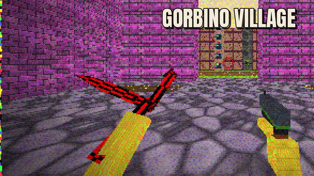 | 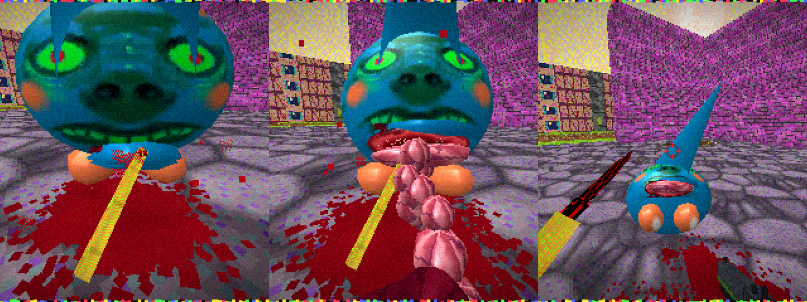 |
| 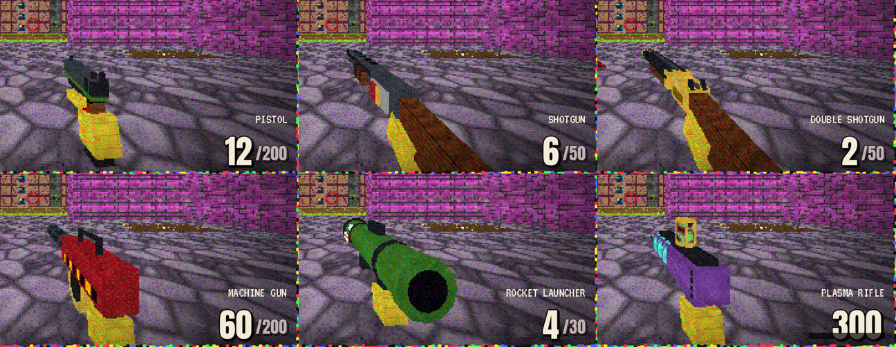 | 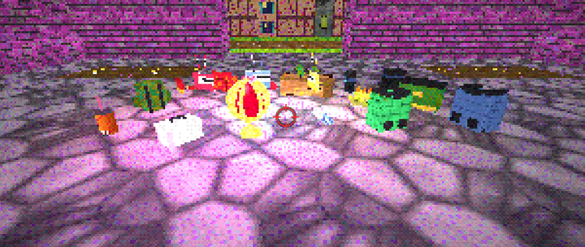 |
| 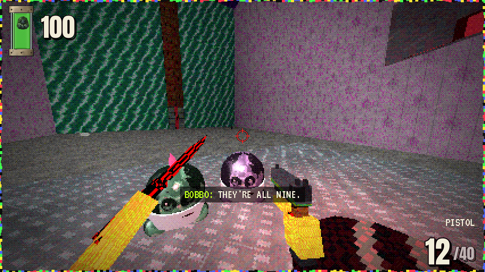 | 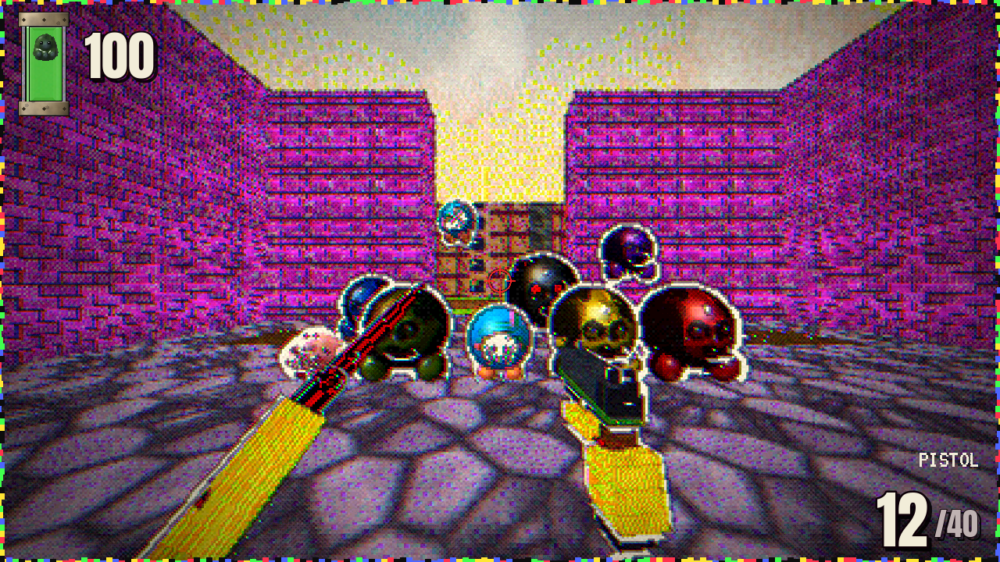 |
| 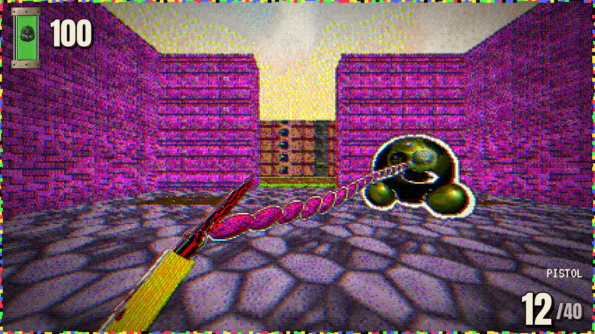 | 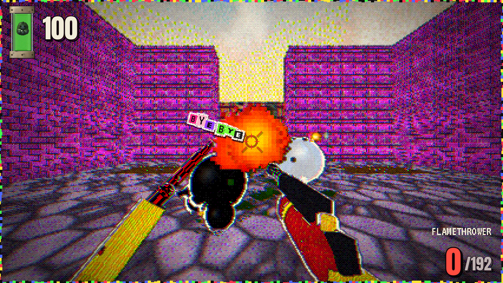 |
| 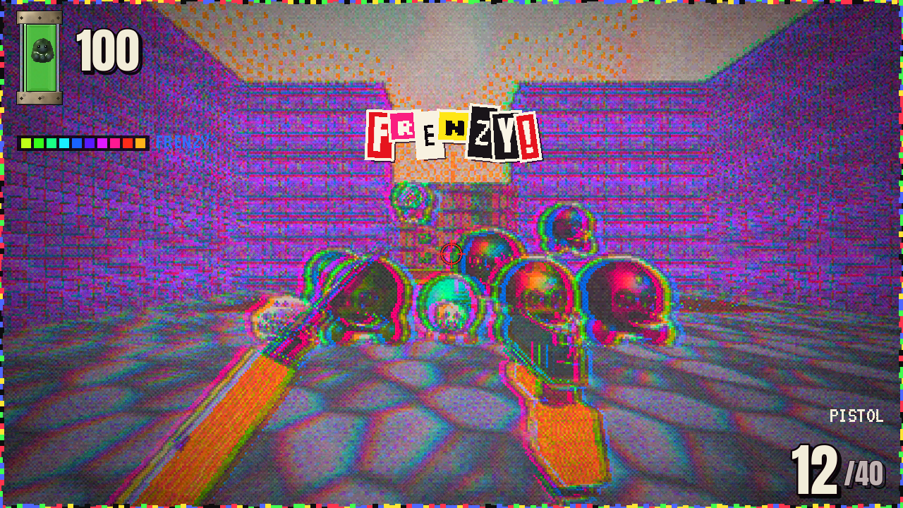 | 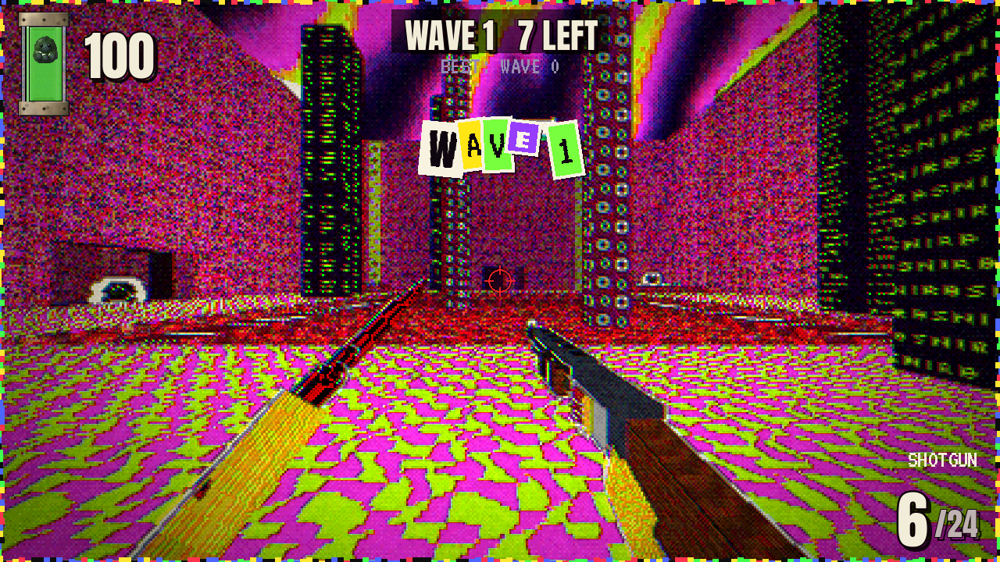 |
| 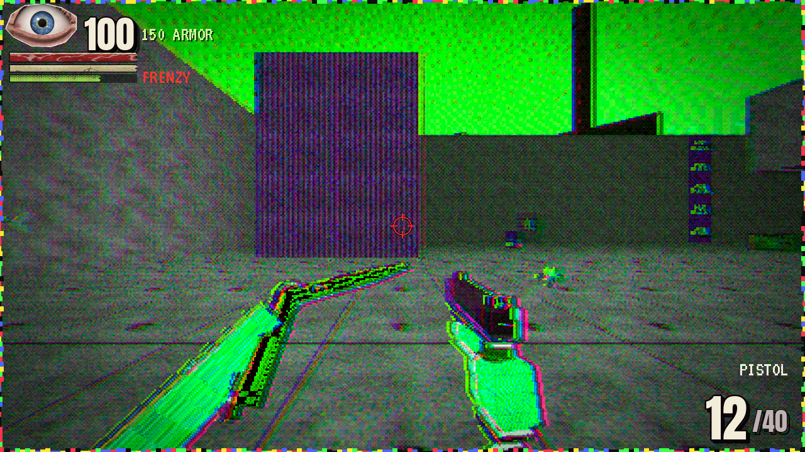 | |

## Playing it

**Windows:** unzip `build/GorbinosQuest-Windows.zip` and run `GorbinosQuest.exe`. It's a single self-contained executable with no installer. It runs on the OpenGL 3.3 "Compatibility" renderer, so almost any GPU from the last 15 years works.

**From source:** install [Godot 4.5.1](https://godotengine.org/download), open `project.godot` and press F5. Or run `godot --path .`.

### Controls (all rebindable in OPTIONS > CONTROLS > KEY BINDINGS)

| Action | Default |
|---|---|
| Move | W A S D / arrow keys |
| Look | Mouse |
| Fire | Left mouse / Ctrl |
| Use / open doors / switches | E / Right mouse |
| Knife: slash, gut a creature in reach, or whip one in from afar | F / Middle mouse |
| Jump | Space |
| Slide | C |
| Sprint | Shift |
| Reload | R |
| Weapons | 1-7, mouse wheel, Q = last weapon |
| Automap | Tab |
| Quick save / quick load | F5 / F9 |
| Pause menu | Esc |

Doors also open when you walk into them, except locked doors (find the keycard) and secret walls (look for odd textures and press USE).

## The game

### The look

Gorbino's Quest is drawn like something cut out of a cheap magazine and pasted together, in the spirit of FISH and Cruelty Squad. The picture comes out like bad print: the colour plates don't quite line up and twitch a few times a second, the shadows are halftone dots, the highlights go to cream paper, ink lines run where colours break, and the colours are pushed hard. Creatures, pickups, your gun and your knife arm are snipped out with white paper borders that boil slightly, so things pop off the background. Kills slap a ransom-note sticker over the action (SPLORT!, GORB!, BLAMMO, BYE BYE...), explosions get cut-out bursts, and the big words on screen are ransom-note letters cut from a dozen magazines. And here and there on the walls of every level, a photo-real trout has been pasted up. The title, pause and death menus' buttons are clay sculptures like the logo: lumpy glossy slabs with their icon and name in orange clay letters; the chosen one lights up pink with a lime rim, and in the pause and death menus a trout nibbles at it. All of it can be switched off with **COLLAGE FX** in OPTIONS > VIDEO.

### Frenzy and the slide

Kills fill the frenzy meter (the strip of fish skin under your health); kills in quick succession fill it faster. When it's full you go into a **FRENZY** for eight seconds: the colours cycle and strobe, the plates fly apart, the music speeds up, you move faster and every gun fires faster, and a gurgling announcer shouts things like MEAT PARADE! and BLORPOCALYPSE!. Kills during a frenzy keep it going.

Press **C** while running to slide: you drop low and shoot along the floor, steering a little, and anything you slide into gets kicked off its feet. Jump out of a slide to keep the speed.

### Endless

**ENDLESS** on the title screen drops you into THE GORB PIT, an arena with a sunken pit, raised corners and pillars, and four alcoves the waves pour out of. Every wave is bigger and nastier than the last, every fifth brings an elite, and between waves there's a short breather with ammo, health and armor; the double shotgun, rocket launcher, flamethrower and plasma rifle arrive as rewards along the way. Your best wave is kept.

### Episode: six levels, one campaign

1. **Gorbino Village**: an open village under a sickly sky, with a plaza, temple, barn, pond and a red-locked town gate.
2. **Snirby Industrial Complex**: loading yards, a sludge-pit processing hall with catwalks, vats, a packaging line and a switch-operated armory.
3. **The Gorbino Mines**: dark caves, crystal caverns, magma, rail tunnels, mine elevators and a very deep shaft.
4. **Consumer Headquarters**: a corporate tower of garish carpets and cubicles, with elevators to the boardroom and a rooftop helipad.
5. **The Endless Gorbino Facility**: cloning vats and a corridor that never ends until you find the right switch.
6. **Snirby Dimension**: flesh islands over an ooze void, and the final boss, **The Great Snirby**.

Each level has its own palette, architecture, music track and ambience, plus 3 secrets, keycards, monster-closet ambushes and checkpoints. The music changes genre from level to level: a music-box waltz in the village, industrial techno in the complex, a dark drone in the mines, bossa nova at headquarters, acid techno in the facility, jungle in the Snirby Dimension, and metal for the boss.

Your health is in the top-left corner: a photo-real cut-out of your eye, your HP, and a strip of raw meat that tears shorter as you take damage. The eye flinches and looks toward whatever just hit you, blinks, goes bloodshot and puffy as you weaken, can barely stay open and weeps blood when you're nearly dead, and rolls back when you die. Under the meat, armor is a strip of bone (its count sits beside your HP) and the frenzy meter is a strip of fish skin that fills as you kill and shimmers through every colour as it burns down during a frenzy.

Ammo pickups are proper objects: trays of brass cartridges, olive ammo cans with a belt hanging off, red shotgun shells on brass heads, finned rockets on a crate, batteries with a glowing band. The HUD shows the ammo of the weapon you're holding.

It is not a comfortable place. Corpses keep twitching, enemies whisper at you while they hunt you, the lights sometimes falter, and things breathe, knock and drag metal around just out of sight. Below 35 health you hear your heart. Between levels there's a story screen and a stats tally (kills, items, secrets, time vs. par) with an S/A/B/C/D rank. Finish level 6 for the ending and credits.

### The knife

Your left hand holds a butterfly knife, and it never sits still: it does real balisong tricks, fanning it open and shut, chaplins over the finger, zen rollovers across the knuckles, helixes, aerials, and flipping it open straight into a stab. The arm is a plain yellow block like the gun hand, and it follows the knife through every trick. The knife looks like it was ripped out of something worse: a crude, bent, low-poly blade, handles studded with teeth and a growth on the pivot, all of it covered in hard red-and-black checks. Press **F** with nobody in reach for a quick slash.

Get close to a creature (a red **[F] GUT** appears under the crosshair) and press **F** to gut it. The camera locks on and you drop to the cut. The knife goes in with a jolt and a moment of slow motion, then drags across the belly while the wound opens behind it: a dark hole with a raw rim, the flaps of skin peeling back, the creature shaking and the cut spurting in pulses like a heartbeat. Then it rips open, the guts slop out onto the floor with a few loose organs, and a loop of intestine comes out snagged on the blade. The creature falls backwards with its belly open to the ceiling and bleeds out into a spreading pool. Nothing can hurt you while you're doing it, or for a moment after. It works on everything that walks; flyers and the final boss are too big or too high.

Aim **F** at a creature further off (a faint **[F] YANK** shows under the crosshair) and a tentacle whips out of your left wrist, wraps round it and hauls it through the air straight onto the knife, and the gut follows. Things too big or too high to haul in just get lashed.

### The locals

Not every Gorbino wants to kill you. Every level has a few pairs of little pastel Gorbinos (pink, mint, peach, lilac, grey) in work smocks and hats, with names like Glorbo, Snorf, Brenda and Lil Gorb. They stand about having gurgly conversations ("WHAT ARE WE PACKING TODAY?" "GORBINOS." "WHAT ARE WE?" "...KEEP PACKING.") with subtitles, and when you walk up they turn and tell you something ("I WAS GROWN IN VAT NINE. NINE IS THE GOOD VAT."). They talk in wet, rolled-R Gorbino gurgles. When the shooting starts they squeal and scatter, they shuffle out of your way, and if one dies its friend notices. The monsters ignore them; your bullets don't.

### Arsenal

| Slot | Weapon | Ammo | Notes |
|---|---|---|---|
| 1 | Pistol | bullets | 12-round mag, accurate. Checkered grip, a Gorbino keychain swinging off it |
| 2 | Shotgun | shells | 6 shells, loaded one at a time (fire to interrupt), pump action. Spare shells duct-taped to the side |
| 3 | Double shotgun | shells | 20 pellets, break-action reload. Engraved brass, a Snirby sticker on the stock |
| 4 | Machine gun | bullets | six spinning barrels, 60-round drum, spread blooms. Hazard paint |
| 5 | Rocket launcher | rockets | splash damage; rocket jumping works. Shark face painted on the tube |
| 6 | Plasma rifle | cells | plasma bolts; no mag but it overheats (press R to vent). A specimen jar on top, something floating in it |
| 7 | Flamethrower | fuel | a short cone of fire. Anything caught in it catches, runs about screaming, sets its friends alight and dies charred and smoking. A red gas canister with a Gorbino sticker; found in the industrial complex's armory, fuel cans after that |

Recoil, muzzle flashes, dynamic muzzle lighting, ejected casings, viewmodel sway and bob, and procedural reload animations are all included. Hits flash a small white marker on the crosshair; kills flash a bigger red one, with a beat of hit-stop. Point-blank shots land even when something is pressed right up against you.

### Bestiary

All Gorbinos share one model in different colours, and move the same way: they hop and bounce, breathe and snap their mouths. All Snirbies share another model and wobble like jelly instead, while still hopping along and pecking in quick bursts: they stretch up before they attack and flatten when they're hurt.

Deaths read the hit. A creature shot from the side spins away from the shot and rolls over on that side; shot from the front it goes over backwards. It shudders in a death throe first, slides with the impact, overshoots and settles, splashes the nearest walls and bleeds out into a pool that slowly spreads. Gorbinos roll onto their backs, Snirbies sag flat with the beak flopped sideways, and flyers drop out of the air and splat. Overkill blows them apart: chunks of meat, bone, loose feet and beaks, strings of gut, and blood up the walls. Corpses keep twitching.

- **Gorbino** (green): lobs goo.
- **Yellow Gorbino**: holds a pistol in one tentacle and fires 3-round hitscan bursts while keeping its distance.
- **Red Gorbino**: a fast melee charger that bites.
- **Blue Gorbino**: a slow tank that fires spreads of ice orbs.
- **Purple Gorbino**: puffs itself up, floats and fires homing orbs.
- **Black Gorbino**: a big elite with glowing eyes and a shoulder rocket launcher.
- **Snirby**: hops fast, pecks and spits.
- **Sky Snirby**: floats, wobbling.
- **Snotling**: the little pink guys. They come in packs of three, scratch and spit.
- **The Great Snirby**: the final boss. It cycles spit fans, summons Snirbies, fires homing barrages and rains fire.

Enemies wake on sight or when they hear gunfire through the level. They path around the map, open doors, strafe, flinch, gib on overkill and drop ammo. Most of them whisper at you when they spot you, and keep whispering while they hunt you.

### Options

Master, music and SFX volume. Difficulty: Mercy, Standard, Cruelty, Hell. Window mode, resolution, **pixel crunch** (render scale 1/1 to 1/6), **colour depth** (8-bit or 12-bit dithered, or true colour), FOV, brightness, vsync and FPS limit. Mouse speed and invert. Full key rebinding. Collage FX on or off. Head bob, crosshair style (circle, dot, cross, none), auto-reload and FPS counter. Settings are saved to `user://settings.cfg`.

### Saving

There's an autosave at the start of every level, and checkpoint totems (the spinning green heads) autosave mid-level. You can save to 3 manual slots from the pause menu, and quick save/load with F5/F9. **Continue Quest** on the title screen lists every save. Saves capture the full level state: enemies, pickups, doors, switches, secrets, keys and inventory.

## How it's built

The whole game is GDScript; scenes are built in code from data.

```
scripts/
  autoload/      settings (config + keybinds), audio (pools, music), game (flow, saves)
  level/         level.gd: grid level builder, sector lighting, doors/lifts, triggers,
                 secrets, teleporters, flow-field pathing; mover.gd; mat.gd (materials)
  player/        player.gd (movement, stairs, damage), weapons.gd (all 6 weapons),
                 offhand.gd (knife arm and its tricks), finisher.gd (slash and gutting)
  enemies/       enemy.gd (AI + variants), creatures.gd (Gorbino/Snirby/Snotling rigs
                 and animation), models.gd (weapons/pickups), projectile.gd,
                 civilian.gd (the locals and what they say)
  fx/collage.gd  the cut-out look: paper borders, stickers; tentacle.gd (the whip),
                 flame_bit.gd (the flamethrower's fire); hyper.gd (the trout on the walls)
  fx/            explosions, blood, gibs, decals, dynamic lights, pickups, barrels, props,
                 gut_rope.gd (spilling intestines)
  game/          game_world.gd (the running level, HUD, pause), dread.gd (the creepy stuff),
                 endless.gd (waves in the Gorb Pit)
  ui/            HUD, menus, intermission, story, ending, splash
  levels/        level data (generated by tools/levels/*.py)
  test/          headless test runner + autopilot bot
  tools/         import_gorbino.gd: splits the supplied Gorbino model into body + feet
shaders/         world (sector light + fog + dynamic lights), post (print/collage look,
                 frenzy, dither), outline (paper cut-out borders), hyperreal (lit photo
                 cut-outs), sky
tools/           asset generators (textures, sprites, fonts, SFX, music) + level kit
```

**Rendering.** Levels are DOOM-style sector grids: every cell has its own floor and ceiling height, textures and light level. The 3D view renders into a low-resolution SubViewport and is upscaled with nearest filtering, then a dithered colour-depth reduction is applied. The world shader samples a per-cell light texture (with flicker, pulse and strobe sectors), applies distance diminishing and coloured fog, and adds up to 6 dynamic point lights.

**Levels** are authored in Python (`tools/levels/*.py`) with a small kit (`tools/levelkit.py`) that carves rooms by coordinates and emits GDScript data plus a top-down preview PNG (`tools/previews/`).

**Assets** are reproducible:

```
python3 tools/gen_textures.py   # 137 textures, 64x64, quantised to the 256-colour GORBPAL
python3 tools/gen_sprites.py    # explosions, flashes, projectiles, UI art, baked bitmap fonts
python3 tools/gen_audio.py      # 81 sound effects incl. formant-synthesised GORB! / SNIRB! voices
python3 tools/gen_music.py      # 10 music tracks (needs ffmpeg with libvorbis); pass names to rebuild only some
python3 tools/gen_creatures.py  # Snotling skin, eyes and mouths; the Gorbino's attack maw
python3 tools/import_user_models.py  # supplied Gorbino texture -> 6 colour variants, Snirby face
godot --headless --path . -s scripts/tools/import_gorbino.gd  # supplied Gorbino mesh -> body + feet
python3 tools/gen_clay.py       # "pre-rendered clay" UI: DEATH, menu buttons, logo, cursor, icon
python3 tools/import_user_audio.py  # weapon sounds, voice lines, enemy shot (idk.wav) from tools/user_audio/
python3 tools/gen_gore.py       # wound, guts and butterfly-knife textures
python3 tools/gen_collage.py    # ransom-note stickers and cut-out bursts
python3 tools/gen_hyperreal.py  # photo-real trout for the walls; the HUD's eye and its meat, bone and fish-skin strips
python3 tools/gen_audio_extra.py  # knife, gore, heartbeat and dread sounds
python3 tools/levels/level1_village.py   # ...and so on for each level
```

(The Python tools need numpy, scipy and Pillow.)

**Your own sounds.** The pistol and machine-gun shots, the shotgun blasts derived from them, and the whispered enemy lines come from the WAV files in `tools/user_audio/`. Put `idk.wav` (or `idk.mp3`) there too and every enemy gunshot, spit and projectile uses it. Rerun `python3 tools/import_user_audio.py` after changing them. Or drop any WAV straight over a file in `assets/sounds/` with the same name.

### Testing

```
tools/check_scripts.sh                                   # static check of every script
godot --headless --path . -- --test                      # build every level, prove the exit is reachable
godot --headless --path . -- --test --savetest           # save/load round trip
godot --headless --path . -- --test --mousetest          # mouse look through the real input path
godot --headless --path . -- --test --steptest           # walking only: lists every ledge you have to jump
godot --headless --fixed-fps 120 --path . -- --autoplay  # a bot plays the whole campaign
godot --headless --fixed-fps 120 --path . -- --autoplay --single --level=3 --arsenal
godot --path . -- --level=1 --guttest=snirby                # gut a creature and screenshot each phase
godot --path . -- --level=4 --civshot                       # go and listen to the locals
godot --path . -- --level=1 --whiptest=green                # whip a creature in and gut it
godot --path . -- --level=1 --flametest                     # set three Gorbinos on fire
godot --path . -- --level=1 --frenzy                        # start in a frenzy
godot --path . -- --level=1 --lineup --lineup-near=0.5      # every creature type, up close
godot --path . -- --level=2 --hp=22 --armor=60              # start hurt (watch the eye suffer)
godot --path . -- --level=2 --pauseshot                     # screenshot the pause menu
godot --path . -- --level=2 --die                           # drop dead (the death menu)
godot --path . -- --level=2 --pausetest                     # drive the pause menu with real key and mouse events
godot --path . -- --endless                                 # straight into ENDLESS
godot --headless --fixed-fps 120 --path . -- --autoplay --endless   # the bot plays ENDLESS
```

The level validator runs a breadth-first search over each map with the player's movement rules, collecting keys and firing switches and triggers, to prove the exit can be reached. The autopilot bot then plays the levels with the real player physics: it paths to keys, switches and exits, opens doors, rides lifts, climbs stairs and fights.

### Exporting

`export_presets.cfg` contains Windows and Linux presets; install the Godot 4.5.1 export templates, then run:

```
godot --headless --path . --export-release "Windows Desktop" build/windows/GorbinosQuest.exe
```

## Credits

- Design, code, art, audio and levels: generated for this project. Fictional publisher: Glandcore Software.
- Fonts (SIL Open Font License, licences in `assets/fonts/`): Silkscreen (Jason Kottke), Bungee (David Jonathan Ross), Anton (Vernon Adams), VT323 (Peter Hull).
- Engine: [Godot Engine](https://godotengine.org) (MIT).
- Gorbino model and texture, Snirby face texture, gun sounds and voice lines: supplied by the project owner.
- This is an unofficial fan work inspired by Gorbino's Quest from the *Cruelty Squad* universe (Consumer Softproducts). It has no affiliation with them.
